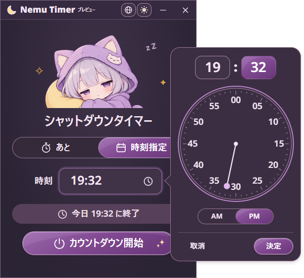

# Nemu Timer

[English](README.md) · [ไทย](README.th.md) · **日本語** · [简体中文](README.zh-CN.md)

Windows のシャットダウンを予約するアプリです。画面の隅で、ネムが残り時間をお知らせします。

**[Windows x64 版をダウンロード](https://github.com/killmebabyx/nemu-timer/releases/latest/download/Nemu.Timer.exe)**

<p>
  
  
</p>

1. **あと** で残り時間を指定するか、**時刻指定** を選んで時刻欄をクリックし、文字盤を開きます。時を選んだ後、上部の分表示をクリックすると1分単位で選べます。**決定** で反映し、時刻欄をもう一度クリックすると変更を破棄して閉じます。予定時刻を確認して **カウントダウン開始** をクリックします。
2. ネムをクリックすると、10分延長したり予約を取り消したりできます。ドラッグで移動できます。残り1分になると操作ボタンが自動で表示されます。
3. 地球のボタンで言語を、月や太陽のボタンでテーマを切り替えます。選択はこのPCに保存されます。

動作環境は Windows x64 と Microsoft Edge WebView2 Runtime です。

<details>
<summary>シャットダウンせずに試す</summary>

起動中の Nemu Timer を閉じ、ダウンロード先のフォルダーで PowerShell を開いて次のコマンドを実行します。カウントダウンが終わってもPCはシャットダウンしません。

```powershell
.\Nemu.Timer.exe --preview
```
</details>
