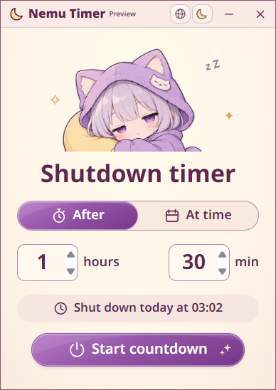

# Nemu Timer

**English** · [ไทย](README.th.md) · [日本語](README.ja.md) · [简体中文](README.zh-CN.md)

A Windows shutdown timer with Nemu, an animated companion who watches the countdown from the corner of your desktop.

**[Download for Windows x64](https://github.com/killmebabyx/nemu-timer/releases/latest/download/Nemu.Timer.exe)**

<p>
  
  
</p>

1. Choose **After** for a delay or **At time** for a specific time. Check the shutdown time, then click **Start countdown**.
2. Click Nemu to add 10 minutes or cancel. Drag her to move her. In the final minute, the controls appear automatically.
3. Use the globe to change language and the moon or sun to switch themes. Nemu remembers both on your PC.

Requires Windows x64 and Microsoft Edge WebView2 Runtime.

<details>
<summary>Try it without shutting down</summary>

Close any running instance. In the download folder, run this PowerShell command. When the countdown ends, your PC stays on.

```powershell
.\Nemu.Timer.exe --preview
```
</details>
