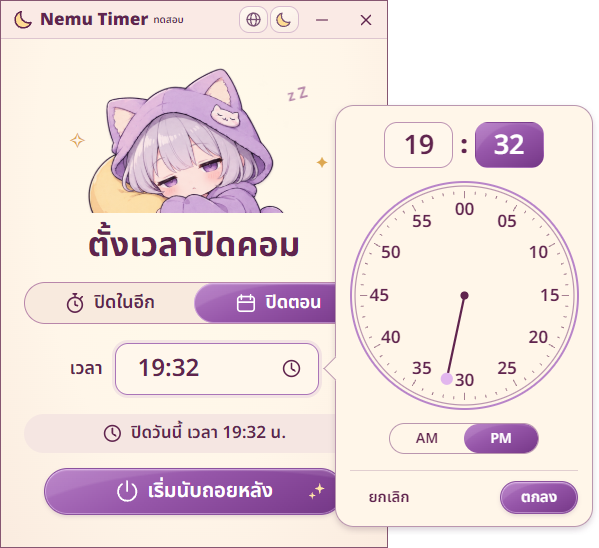

# Nemu Timer

[English](README.md) · **ไทย** · [日本語](README.ja.md) · [简体中文](README.zh-CN.md)

ตั้งเวลาปิดคอมบน Windows โดยมีน้องเนมุคอยบอกเวลาที่เหลืออยู่มุมจอ

**[ดาวน์โหลดสำหรับ Windows x64](https://github.com/killmebabyx/nemu-timer/releases/latest/download/Nemu.Timer.exe)**

<p>
  
  
</p>

1. เลือก **ปิดในอีก** เพื่อตั้งระยะเวลา หรือ **ปิดตอน** แล้วกดช่องเวลาเพื่อเปิดหน้าปัด เลือกชั่วโมง จากนั้นกดตัวเลขนาทีด้านบนเมื่อต้องการเลือกนาที กด **ตกลง** เพื่อใช้เวลาใหม่ หรือกดช่องเวลาเดิมซ้ำเพื่อปิดโดยไม่บันทึก ตรวจเวลาแล้วกด **เริ่มนับถอยหลัง**
2. คลิกน้องเพื่อเพิ่ม 10 นาทีหรือยกเลิก ลากน้องเพื่อย้ายตำแหน่ง เมื่อเหลือหนึ่งนาที ปุ่มจะปรากฏขึ้นเอง
3. เปลี่ยนภาษาที่รูปลูกโลก สลับธีมที่รูปพระจันทร์หรือดวงอาทิตย์ โปรแกรมจำทั้งสองค่าไว้ในเครื่อง

ใช้กับ Windows x64 และต้องมี Microsoft Edge WebView2 Runtime

<details>
<summary>ลองใช้โดยไม่ปิดเครื่อง</summary>

ปิด Nemu Timer ที่เปิดอยู่ก่อน แล้วเปิด PowerShell ในโฟลเดอร์ดาวน์โหลดและรันคำสั่งนี้ เมื่อครบเวลา เครื่องจะยังเปิดอยู่

```powershell
.\Nemu.Timer.exe --preview
```
</details>
